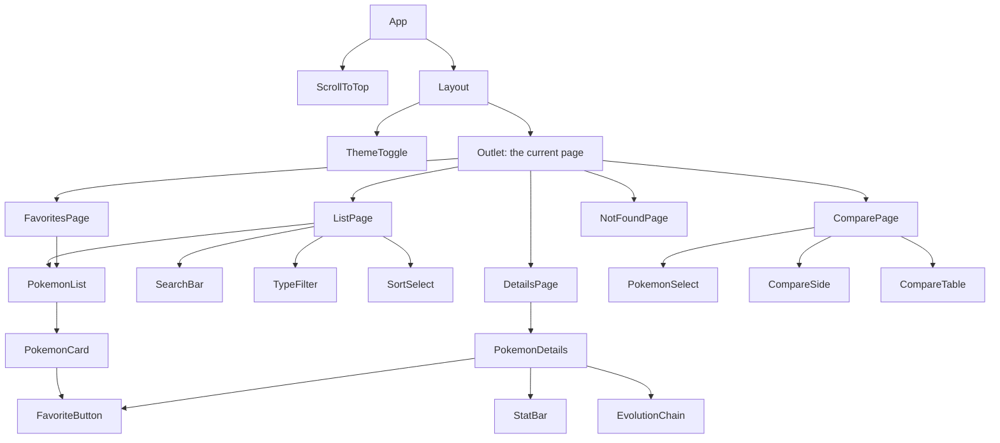

# Architecture

How the Pokédex is built: the pages, the components and how the data moves between them.

## Pages and addresses
The addresses are defined in one place, `src/App.tsx`, with `<Routes>` and `<Route>`. `BrowserRouter` wraps the app in `src/main.tsx`.

| Address | Page file | Notes |
| --- | --- | --- |
| `/` | none | `<Navigate>` sends the user to `/items` |
| `/items` | `pages/ListPage.tsx` | Search, type filter, sort, random |
| `/items/:id` | `pages/DetailsPage.tsx` | `useParams` reads the id; a bad id shows the not found page |
| `/favorites` | `pages/FavoritesPage.tsx` | The saved Pokémon |
| `/compare?a=1&b=25` | `pages/ComparePage.tsx` | `useSearchParams` reads and writes the choice |
| anything else | `pages/NotFoundPage.tsx` | `path="*"` |

All of these are nested inside a `<Route>` with no address that draws `components/Layout.tsx`: the header and the `NavLink` menu. `<Outlet />` in `Layout` is where the current page appears.

## Component tree

`StatusMessage`, `ListStatus` and `SkeletonList` show the loading and error states on several pages.

## Where the state lives, and why

| State | Where | Why there |
| --- | --- | --- |
| The list of 151 | `usePokemonList`, called in `App` | Three pages need it; it is loaded once and survives moving between pages |
| Favorites | `useFavorites`, called in `App`, saved in `localStorage` | The header count and the pages all need it |
| Theme | `useTheme`, called in `App`, saved in `localStorage` | Belongs to the whole app |
| Search, type, sort | `useState` in `App` | `ListPage` disappears when a details page opens; in `App` the filters are still there on return |
| Loaded types | `useTypeIds`, called in `ListPage` | Only this page uses it |
| The current Pokémon's data | `usePokemonDetail`, called in `DetailsPage` and twice in `ComparePage` | Only the page that shows it needs it |
| Shiny on/off | `useState` in `PokemonDetails` | Only this component uses it; `key={pokemon.id}` resets it for each Pokémon |
| Selected id | The address (`/items/25`) | A refresh and a shared link keep working |
| Compare choice | The address (`?a=1&b=25`) | Same reason |

**Calculated, not stored:** the visible list (`getVisiblePokemon`) and the loading status of a type or a Pokémon are calculated on every render, so they can never disagree with the state they come from.

## What happens from a click to the details
1. `PokemonCard` is a `<Link to="/items/25">`. Clicking it changes the address without reloading the page.
2. The router matches `items/:id` and draws `DetailsPage` in the `Outlet`.
3. `DetailsPage` reads `id` with `useParams` and checks it with `parsePokemonId`. A bad id shows `NotFoundPage`.
4. `usePokemonDetail(25)` returns status `loading`, so the page shows `StatusMessage`.
5. Its `useEffect` calls `fetch` for `/pokemon/25` and `/pokemon-species/25` together (`Promise.all`), then for the evolution chain, whose address comes from the species.
6. `toPokemonDetail` turns the three answers into one simple `PokemonDetail`, and `setLoaded` saves it.
7. React renders again. The status is now `success`, and `PokemonDetails` gets the data in props.

If the id changes while requests are running, the effect's cleanup calls `controller.abort()`, so a slow old answer cannot replace the new Pokémon.

## Types
`src/types/pokemon.ts` has two groups: `Api...` types describe the JSON from PokéAPI, and the others (`PokemonSummary`, `PokemonDetail`...) are the shapes the components use. `fetchJson<T>` says which type each request returns. Each component declares an `interface` for its props. There is no `any`, and `npm run lint` fails if someone adds one.

## Tests
| File | What it checks |
| --- | --- |
| `utils/pokemon.test.ts` | Search, filter, sort, id validation, compare, evolution stages, API data conversion |
| `utils/api.test.ts` | `fetchJson` on good and failed answers, the error helpers |
| `hooks/useFavorites.test.ts` | Adding, removing, saving, broken saved data |
| `components/PokemonCard.test.tsx` | The link address, and that the heart reports the right id |
| `pages/DetailsPage.test.tsx` | Id from the address, loading, error and retry, not found (with a fake `fetch`) |

## Adding something new
For example, a "Recently viewed" page:
1. Add a `useRecentlyViewed` hook, like `useFavorites`, and call it in `App`.
2. Add `pages/RecentPage.tsx`, reusing `PokemonList`.
3. Add a `<Route path="recent">` in `App.tsx` and a `NavLink` in `Layout.tsx`.
